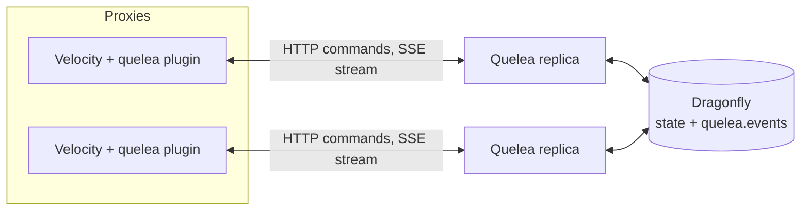

# Quelea

Quelea is the party system for the OneLiteFeather network. Players form a party and invite each other by name. When the party leader joins a game from the lobby, the members in the lobby follow onto that exact server. The state lives in a shared Dragonfly, so parties work across several Velocity proxies and any number of service replicas.

## How it works

Each Velocity proxy runs the `velocity` plugin. The plugin reports logins, disconnects and a heartbeat to the `backend` service over plain HTTP, and it keeps one Server-Sent Events (SSE) stream open to receive party events. Commands from players are sent to the service, which stores all party state in Dragonfly and publishes every change on the Redis channel `quelea.events`. Each replica forwards these events to its open streams.



**Follow rule.** When the proxy sees the party leader connect to a server that does not match the lobby pattern (`QUELEA_LOBBY_PATTERN`), it asks the service to warp the party. Every proxy then moves its local members to that exact server. With the default follow mode `lobby`, only members who are in a lobby follow; members already in another game stay where they are.

Events are delivered at most once. A proxy that reconnects does not receive events it missed, so a warp that was lost can be repeated with `/party warp`.

## Modules

| Module    | Artifact / output                                  | Purpose                                                                 |
|-----------|----------------------------------------------------|-------------------------------------------------------------------------|
| `backend` | Docker image `harbor.onelitefeather.dev/onelitefeather/quelea` | Micronaut HTTP service: parties, invites, presence, events, metrics.    |
| `client`  | `net.onelitefeather:quelea-client`                 | Java client generated from the backend's OpenAPI document.              |
| `velocity`| `quelea-velocity-<version>.jar` on every GitHub release | Velocity proxy plugin: commands, follow, presence reporting.       |

## Player commands

`/party` has the alias `/p`. Running it without arguments prints the help.

| Command                    | Who                | Effect                                                                                  |
|----------------------------|--------------------|-----------------------------------------------------------------------------------------|
| `/party create`            | any player         | Creates a party with you as leader. Refused if you are already in one.                 |
| `/party invite <player>`   | leader             | Invites an online player. Creates a party if you are not in one. The invite expires after 60 s. |
| `/party accept [inviter]`  | invited player     | Joins the party. Without a name, works when exactly one invite is pending; otherwise lists the inviters. |
| `/party deny [inviter]`    | invited player     | Declines an invite. Same name rule as `accept`.                                         |
| `/party leave`             | member             | Leaves the party. If the leader leaves, the longest-standing member becomes leader.     |
| `/party kick <player>`     | leader             | Removes a member.                                                                       |
| `/party promote <player>`  | leader             | Makes a member the leader.                                                              |
| `/party disband`           | leader             | Ends the party for everyone.                                                            |
| `/party list`              | any member         | Shows the members of your party.                                                        |
| `/party warp`             | leader             | Moves the party to your current server. Use it to retry a warp that did not reach the members. |
| `/pc <message>`            | member             | Sends a message to the party chat (1 to 256 characters).                                |

Messages are shown in English or German, following the player's client language.

## Configuration

### Backend (environment variables)

Set these on the service. Defaults are in `backend/src/main/resources/application.yml`.

| Variable                       | Default                     | Meaning                                                                       |
|--------------------------------|-----------------------------|-------------------------------------------------------------------------------|
| `PORT`                         | `8080`                      | HTTP port of the service.                                                     |
| `REDIS_URI`                    | `redis://localhost:6379`    | Dragonfly (Redis protocol) that holds all state.                              |
| `QUELEA_REDIS_PREFIX`          | `quelea:`                   | Prefix of every key, so several environments can share one Dragonfly.        |
| `QUELEA_REDIS_LOCK_TTL`        | `3s`                        | Lease of a party lock. A holder that stalls longer loses the lock.            |
| `QUELEA_REDIS_LOCK_WAIT`       | `1s`                        | How long a request waits for a busy party lock before it fails with `lock-timeout`. |
| `QUELEA_PARTY_MAX_SIZE`        | `8`                         | Maximum members per party, counting the leader. Minimum 2.                    |
| `QUELEA_INVITE_TTL`            | `60s`                       | How long an invite stays valid. Re-inviting refreshes it.                     |
| `QUELEA_PROXY_TIMEOUT`         | `45s`                       | A proxy without a heartbeat for this long is treated as dead; its players are disconnected from their parties. |
| `QUELEA_SSE_KEEPALIVE`         | `15s`                       | Interval of the keep-alive comment on idle event streams.                     |
| `LOG_JSON`                     | `false`                     | `true` writes logs as JSON with `trace_id` and `span_id`.                     |
| `OTEL_TRACES_EXPORTER`         | `none`                      | Set to `otlp` to export traces.                                               |
| `OTEL_EXPORTER_OTLP_ENDPOINT`  | `http://localhost:4317`     | OTLP gRPC endpoint for traces.                                                |
| `OTEL_SERVICE_NAME`            | `quelea`                    | Service name on traces.                                                       |

### Plugin (`plugins/quelea/config.properties`)

On the first start the plugin creates this file with commented defaults. Each value can also be set by the environment variable shown; the environment wins over the file.

| File key        | Environment variable  | Default                   | Meaning                                                                 |
|-----------------|-----------------------|---------------------------|-------------------------------------------------------------------------|
| `url`           | `QUELEA_URL`          | `http://localhost:8080`   | Base URL of the party service.                                          |
| `proxy-id`      | `QUELEA_PROXY_ID`     | random UUID per start     | Name of this proxy in the service. Set it to keep a stable identity.   |
| `lobby-pattern` | `QUELEA_LOBBY_PATTERN`| `(?i)^lobby.*`            | Regex for lobby server names. Moves to other servers warp the party.    |
| `follow-mode`   | `QUELEA_FOLLOW_MODE`  | `lobby`                   | Which members follow a warp: `lobby` (only members in a lobby) or `always`. |

## Installing the plugin

1. Download `quelea-velocity-<version>.jar` from the GitHub release and put it into the Velocity proxy template, next to the other plugins.
2. Set `QUELEA_URL` on the proxy. In production this is `https://quelea.apps.onelite.feather`. The proxy must trust the internal certificate authority for that host.
3. Start the proxy. The plugin logs an error and disables itself if the configuration cannot be loaded.

The proxy keeps one SSE stream open to the service. The gateway route for the service must not apply a request timeout, or the stream is cut.

## Operations

- **Health:** `GET /health`. Reports the state of the Dragonfly connection.
- **Metrics:** `GET /prometheus` (Prometheus format).
  - `quelea_party_operations_total{operation,result}`: service calls by operation and result.
  - `quelea_parties_active`: parties currently stored.
  - `quelea_sse_streams`: open event streams on this replica.
  - `quelea_events_published_total{type}`: party events published, by type.
  - `quelea_events_failed_total{type}`: party events that could not be published, by type.
- **Traces:** OpenTelemetry over OTLP when `OTEL_TRACES_EXPORTER=otlp`. The trace context is carried inside each event, so a warp can be traced from the leader's request to the fan-out.
- **Logs:** plain text by default; JSON with `LOG_JSON=true`.
- **Errors:** every error is an RFC 9457 Problem Details document (`application/problem+json`) with a stable `code`, for example `party-full` or `not-leader`. Each code and what to do about it is documented in [docs/problems.md](docs/problems.md). Quote the `traceId` from the response when you report a problem.

## Development

Requirements: JDK 25 and Docker.

```sh
# Start Dragonfly on localhost:6379
docker compose -f docker/docker-compose.yml up -d

# Run the service against it
./gradlew :backend:run

# Run a local Velocity proxy with the plugin (QUELEA_URL defaults to http://localhost:8080)
./gradlew :velocity:runVelocity

# Full build
./gradlew build

# Unit tests only (no Docker needed)
./gradlew :backend:test -PexcludeTags=integration
```

Integration tests use Testcontainers and need a running Docker daemon. They are tagged `integration`.

Specifications and the change history live in `openspec/`.

## License

[AGPL-3.0](LICENSE)
