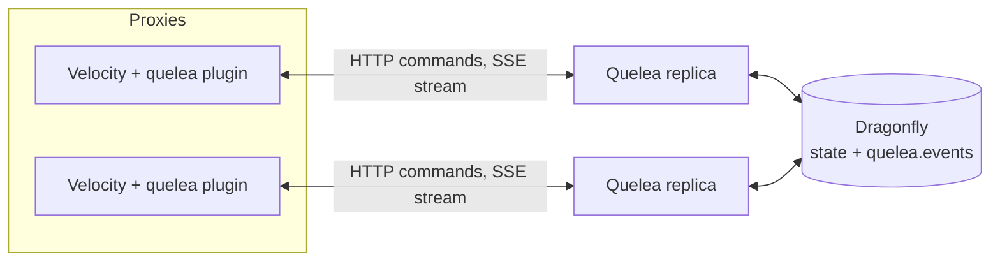

# Quelea

Quelea is the party system for the OneLiteFeather network. Players form a party and invite each other by name. When the party leader joins a game from the lobby, the members in the lobby follow onto that exact server. The state lives in a shared Dragonfly, so parties work across several Velocity proxies and any number of service replicas.

## How it works

Each Velocity proxy runs the `velocity` plugin. The plugin reports logins, disconnects and a heartbeat to the `backend` service over plain HTTP, and it keeps one Server-Sent Events (SSE) stream open to receive party events. Commands from players are sent to the service, which stores all party state in Dragonfly and publishes every change on the Redis channel `quelea.events`. Each replica forwards these events to its open streams.



**Follow rule.** Whenever the proxy sees the party leader move from one server to another, it asks the service to warp the party to the new server and names the server the leader left. Every proxy then moves its local members to that exact server. With the default follow mode `lobby`, a member follows if they were on the server the leader left (they were together) or if they are in a lobby (`QUELEA_LOBBY_PATTERN`); a member in another game stays where they are. So a round that ends brings the party back to the lobby with its leader, and a lobby hop drags the other lobby members along. The leader's first connection after login warps nothing.

Events are delivered at most once. A proxy that reconnects does not receive events it missed, so a warp that was lost can be repeated with `/party warp`.

**Lonely parties.** A party that still has only its creator after `QUELEA_PARTY_ALONE_TIMEOUT` is disbanded. `QUELEA_PARTY_ALONE_WARNING` before that, the service publishes `party.expiring` with the expiry time, and the proxy tells the leader how many minutes are left. Expired parties are disbanded with the reason `expired-alone`. Every `party.disbanded` event carries a `reason`: `leader` (the leader disbanded), `last-member-left` (only one member remained) or `expired-alone`. Clients must treat an unknown reason like `leader`.

**Party versions and conditional requests.** Every party has a `version`: 1 when it is created, +1 with every change. It is in the party JSON and in every event. `GET /v1/parties/{id}` and `GET /v1/players/{id}/party` send it as a strong `ETag` (for example `"4"`) and answer `304 Not Modified` without a body when `If-None-Match` names the current tag. `kick`, `promote`, `disband` and `warp` accept `If-Match` with one or more strong tags or `*`. If none matches the current version, the command changes nothing and answers `412 precondition-failed`. A weak tag (`W/`) never matches. Without the header the command runs unconditionally.

**Retries.** A `POST` may carry an `Idempotency-Key` header (1 to 255 visible ASCII characters). The first request with a key runs; a 2xx response is stored for `QUELEA_IDEMPOTENCY_TTL`, and a repeat with the same key and the same request is answered with the stored response without running again. The key is scoped to the authenticated client. The same key with another request answers `422 idempotency-key-reused`; a repeat while the first request is still running answers `409 request-in-progress` with `Retry-After: 1`. Failed responses are not stored, so a retry after an error runs again. The key is kept for `QUELEA_IDEMPOTENCY_LOCK` while a request runs, so a crashed request does not block its key for longer than that.

**Event streams.** Each stream of `GET /v1/events` identifies its client with `clientId` (`proxyId` is accepted as an alias). A client that falls more than `QUELEA_SSE_BUFFER` events behind has its stream closed and counted in `quelea.sse.disconnects{reason="overflow"}`; it must reconnect and take a fresh snapshot. A stream also ends when the token it was opened with expires, so it never outlives its credentials; the client reconnects with a fresh token and takes a snapshot.

## Modules

| Module    | Artifact / output                                  | Purpose                                                                 |
|-----------|----------------------------------------------------|-------------------------------------------------------------------------|
| `backend` | Docker image `harbor.onelitefeather.dev/onelitefeather/quelea` | Micronaut HTTP service: parties, invites, presence, events, metrics.    |
| `client`  | `net.onelitefeather:quelea-client`                 | Java client generated from the backend's OpenAPI document.              |
| `velocity`| `quelea-velocity-<version>.jar` on every GitHub release | Velocity proxy plugin: commands, follow, presence reporting.       |

## Player commands

`/party` has the alias `/p`. Running it without arguments prints the help.

| Command                    | Who                | Effect                                                                                  |
|----------------------------|--------------------|-----------------------------------------------------------------------------------------|
| `/party create`            | any player         | Creates a party with you as leader. Refused if you are already in one.                 |
| `/party invite <player>`   | leader             | Invites an online player. Creates a party if you are not in one. The invite expires after 60 s. |
| `/party accept [inviter]`  | invited player     | Joins the party. Without a name, works when exactly one invite is pending; otherwise lists the inviters. |
| `/party deny [inviter]`    | invited player     | Declines an invite. Same name rule as `accept`.                                         |
| `/party leave`             | member             | Leaves the party. If the leader leaves, the longest-standing member becomes leader.     |
| `/party kick <player>`     | leader             | Removes a member.                                                                       |
| `/party promote <player>`  | leader             | Makes a member the leader.                                                              |
| `/party disband`           | leader             | Ends the party for everyone.                                                            |
| `/party list`              | any member         | Shows the members of your party.                                                        |
| `/party warp`             | leader             | Moves the party to your current server. Use it to retry a warp that did not reach the members. |
| `/pc <message>`            | member             | Sends a message to the party chat (1 to 256 characters).                                |

Messages are shown in English or German, following the player's client language.

### Languages and message overrides

The plugin ships English and German. A player sees the bundle for their client locale: `de_DE`, then `de`, then `en`. A key that is missing in the chosen bundle is shown in English, so a partial translation never shows a raw key.

To change or add messages without a new release, put a file named `messages_<tag>.properties` into `plugins/quelea/lang/` on the proxy (for example in the proxy template, next to `config.properties`):

- **Override single messages:** `messages_de.properties` with only the keys to change. Every other German text stays built in.
- **Add a language:** `messages_fr.properties` translates the keys it wants; the rest of the messages are English until they are translated.
- **Regional variants:** `messages_de_AT.properties` is used for Austrian clients and falls back to `de`, then `en`.

The files are read once at proxy start-up, so restart the proxy after a change. Each value is a MiniMessage template. Copy the keys from the built-in `messages_en.properties` in the plugin jar (`lang/`), and keep the placeholders (`<name>`, `<count>`, `<server>` and so on) as they are. If a template does not parse, the proxy logs a warning naming the key and language, and that message is shown in English.

The colour guide at the top of `messages_en.properties` explains which colour means what (commands, arguments, errors, hints, the leader's star).

## Configuration

### Backend (environment variables)

Set these on the service. Defaults are in `backend/src/main/resources/application.yml`.

| Variable                       | Default                     | Meaning                                                                       |
|--------------------------------|-----------------------------|-------------------------------------------------------------------------------|
| `PORT`                         | `8080`                      | HTTP port of the service.                                                     |
| `REDIS_URI`                    | `redis://localhost:6379`    | Dragonfly (Redis protocol) that holds all state.                              |
| `QUELEA_REDIS_PREFIX`          | `quelea:`                   | Prefix of every key, so several environments can share one Dragonfly.        |
| `QUELEA_REDIS_LOCK_TTL`        | `3s`                        | Lease of a party lock. A holder that stalls longer loses the lock.            |
| `QUELEA_REDIS_LOCK_WAIT`       | `1s`                        | How long a request waits for a busy party lock before it fails with `lock-timeout`. |
| `QUELEA_PARTY_MAX_SIZE`        | `8`                         | Maximum members per party, counting the leader. Minimum 2.                    |
| `QUELEA_INVITE_TTL`            | `60s`                       | How long an invite stays valid. Re-inviting refreshes it.                     |
| `QUELEA_PARTY_ALONE_TIMEOUT`   | `30m`                       | A party that has only its creator for this long is disbanded with reason `expired-alone`. |
| `QUELEA_PARTY_ALONE_WARNING`   | `5m`                        | `party.expiring` is published this long before the expiry. `0s` disables the warning. |
| `QUELEA_PARTY_EXPIRY_INTERVAL` | `15s`                       | How often the expiry job runs; one replica per run, under a lock. The expiry can be this late. |
| `QUELEA_PROXY_TIMEOUT`         | `45s`                       | A proxy without a heartbeat for this long is treated as dead; its players are disconnected from their parties. |
| `QUELEA_SSE_KEEPALIVE`         | `15s`                       | Interval of the keep-alive comment on idle event streams.                     |
| `QUELEA_SSE_BUFFER`            | `256`                       | Events one stream may hold unread. A stream that overflows is closed.         |
| `QUELEA_IDEMPOTENCY_TTL`       | `24h`                       | How long the response of a completed `POST` is replayed for its `Idempotency-Key`. |
| `QUELEA_IDEMPOTENCY_LOCK`      | `10s`                       | Marker of a request in progress. A duplicate within this time answers `409 request-in-progress`. |
| `QUELEA_AUTH_ISSUER`           | `http://localhost:18090/quelea` | Token issuer (`iss`). Outside `dev`/`test` it must be an https URL, for example `https://login.microsoftonline.com/<tenant>/v2.0`. |
| `QUELEA_AUTH_AUDIENCE`         | `quelea-api`                | Token audience (`aud`). Outside `dev`/`test` the client id GUID of the Quelea API registration. |
| `QUELEA_AUTH_TENANT_ID`        | empty                       | Entra tenant id; tokens of another tenant are refused. Required outside `dev`/`test`. |
| `QUELEA_AUTH_JWKS_URL`         | `http://localhost:18090/quelea/jwks` | Where the issuer publishes its signing keys (RS256 only).           |
| `QUELEA_AUTH_CLOCK_SKEW`       | `60s`                       | Tolerated clock difference for `exp` and `nbf`. Between `0s` and `60s`; larger values stop the service. |
| `LOG_JSON`                     | `false`                     | `true` writes logs as JSON with `trace_id` and `span_id`.                     |
| `OTEL_TRACES_EXPORTER`         | `none`                      | Set to `otlp` to export traces.                                               |
| `OTEL_EXPORTER_OTLP_ENDPOINT`  | `http://localhost:4317`     | OTLP gRPC endpoint for traces.                                                |
| `OTEL_SERVICE_NAME`            | `quelea`                    | Service name on traces and metrics (read from the environment by the metrics exporter too). |
| `QUELEA_METRICS_OTLP_ENABLED`  | `false`                     | `true` pushes metrics over OTLP/HTTP.                                         |
| `QUELEA_METRICS_OTLP_URL`      | `http://localhost:4318/v1/metrics` | OTLP/HTTP metrics endpoint, for example `http://alloy-receiver.grafana.svc:4318/v1/metrics`. |
| `QUELEA_METRICS_OTLP_STEP`     | `60s`                       | Interval at which metrics are pushed.                                         |

### Plugin (`plugins/quelea/config.properties`)

On the first start the plugin creates this file with commented defaults. Each value can also be set by the environment variable shown; the environment wins over the file.

| File key        | Environment variable  | Default                   | Meaning                                                                 |
|-----------------|-----------------------|---------------------------|-------------------------------------------------------------------------|
| `url`           | `QUELEA_URL`          | `http://localhost:8080`   | Base URL of the party service.                                          |
| `proxy-id`      | `QUELEA_PROXY_ID`     | random UUID per start     | Name of this proxy in the service. Set it to keep a stable identity.   |
| `lobby-pattern` | `QUELEA_LOBBY_PATTERN`| `(?i)^lobby.*`            | Regex for lobby server names. Moves to other servers warp the party.    |
| `follow-mode`   | `QUELEA_FOLLOW_MODE`  | `lobby`                   | Which members follow a warp: `lobby` (only members in a lobby) or `always`. |
| `tenant-id`     | `QUELEA_TENANT_ID`    | none                      | Entra tenant (GUID or domain) of the plugin's app registration.          |
| `client-id`     | `QUELEA_CLIENT_ID`    | none                      | Client id of the plugin's app registration.                              |
| `client-secret` | `QUELEA_CLIENT_SECRET`| none                      | Secret of that app registration. Prefer the environment for it.          |
| `auth-scope`    | `QUELEA_AUTH_SCOPE`   | none                      | Token scope, `api://<client id of the Quelea API>/.default`.             |

The four credential values come from the Entra app registration of the plugin, described in [`docs/entra-setup.md`](docs/entra-setup.md). Without all of them the plugin sends no token, logs one warning at start-up, and only a `dev` party service accepts its requests.

## Installing the plugin

1. Download `quelea-velocity-<version>.jar` from the GitHub release and put it into the Velocity proxy template, next to the other plugins.
2. Set `QUELEA_URL` on the proxy. In production this is `https://quelea.apps.onelite.feather`. The proxy must trust the internal certificate authority for that host.
3. Start the proxy. The plugin logs an error and disables itself if the configuration cannot be loaded.

The proxy keeps one SSE stream open to the service. The gateway route for the service must not apply a request timeout, or the stream is cut.

## Operations

- **Health:** `GET /health`. Reports the state of the Dragonfly connection.
- **Metrics:** pushed over OTLP/HTTP when `QUELEA_METRICS_OTLP_ENABLED=true`, to `QUELEA_METRICS_OTLP_URL` every `QUELEA_METRICS_OTLP_STEP`. There is no scrape endpoint; `/prometheus` answers 404. Names keep their Prometheus form in Mimir, for example `quelea_party_operations_total`. Each replica reports its pod name (`HOSTNAME`) as `service.instance.id`.
  - `quelea_party_operations_total{operation,result}`: service calls by operation and result.
  - `quelea_parties_active`: parties currently stored.
  - `quelea_parties_created_total`: parties created.
  - `quelea_parties_disbanded_total{reason}`: parties disbanded, by reason (`leader`, `last-member-left`, `expired-alone`).
  - `quelea_party_lifetime_seconds_*{reason}`: time from creation to disband, by reason (histogram).
  - `quelea_party_size_*`: party size after each join, counting the leader (histogram).
  - `quelea_players_online`: players online on all proxies, read from the presence store.
  - `quelea_sse_streams`: open event streams on this replica.
  - `quelea_events_published_total{type}`: party events published, by type.
  - `quelea_events_failed_total{type}`: party events that could not be published, by type.
- **Traces:** OpenTelemetry over OTLP when `OTEL_TRACES_EXPORTER=otlp`. The trace context is carried inside each event, so a warp can be traced from the leader's request to the fan-out.
- **Logs:** plain text by default; JSON with `LOG_JSON=true`.
- **Errors:** every error is an RFC 9457 Problem Details document (`application/problem+json`) with a stable `code`, for example `party-full` or `not-leader`. Each code and what to do about it is documented in [docs/problems.md](docs/problems.md). Quote the `traceId` from the response when you report a problem.

## Rolling out authentication

The plugin must be rolled out before the backend enforces authentication, because the 0.1.0 plugin cannot authenticate:

1. Create the Entra app registrations (see [docs/entra-setup.md](docs/entra-setup.md)).
2. Release the plugin and install it on the proxies with its client credentials (`QUELEA_TENANT_ID`, `QUELEA_CLIENT_ID`, `QUELEA_CLIENT_SECRET`, `QUELEA_AUTH_SCOPE`). The 0.1.0 backend ignores the new headers, so this step is safe.
3. Update the backend with the `QUELEA_AUTH_*` values (`QUELEA_AUTH_ISSUER`, `QUELEA_AUTH_AUDIENCE`, `QUELEA_AUTH_TENANT_ID`, `QUELEA_AUTH_JWKS_URL`). From this point every route except `/health` and the API documentation requires a token.

## Development

Requirements: JDK 25 and Docker.

```sh
# Start Dragonfly on localhost:6379
docker compose -f docker/docker-compose.yml up -d

# Run the service against it
./gradlew :backend:run

# Run a local Velocity proxy with the plugin (QUELEA_URL defaults to http://localhost:8080)
./gradlew :velocity:runVelocity

# Full build
./gradlew build

# Unit tests only (no Docker needed)
./gradlew :backend:test -PexcludeTags=integration
```

Integration tests use Testcontainers and need a running Docker daemon. They are tagged `integration`.

Specifications and the change history live in `openspec/`.

## CI

Every pull request runs:

- **Build:** the shared OneLiteFeather Gradle workflow (`build test`, JDK 25).
- **API compatibility:** `oasdiff` compares the OpenAPI document of the base with the head and fails on breaking changes. The changelog goes to the job summary (`.github/workflows/api-diff.yml`).
- **Coverage:** JaCoCo XML and HTML reports for `backend` and `velocity`, uploaded to Codecov and as a workflow artifact. Coverage has no threshold and never fails the build (`.github/workflows/build-pr.yml`).

## License

[AGPL-3.0](LICENSE)
